# QueryPilot — The Safe, Self-Correcting AI Analytics Engineer

> **Ask business questions in plain English. Get verified SQL, interactive charts, and evidence-backed answers—powered by Google Gemini, without risking your database or trusting AI hallucinations.**

---

## 1. What is QueryPilot? (In Plain English)

Imagine you are a store manager or product owner and you want to know:
* *"Which product categories generated the most revenue this year?"*
* *"Why did our sales drop last month compared to August?"*
* *"Which regions have the highest order cancellation rates?"*

Normally, you either have to **know SQL** (the programming language used to talk to databases) or **wait days for a data analyst** to write the query, build a chart, and summarize the numbers.

**QueryPilot** solves this by acting like a **virtual Analytics Engineer**. You type a question in everyday English, and QueryPilot:
1. **Checks your database map (schema)** to see what tables and fields actually exist.
2. **Writes a safe SQL query** using **Google Gemini** (`gemini-2.5-flash` configured in `.env`).
3. **Double-checks the query for safety and impact** before running it.
4. **Runs the query on a read-only connection** so it can never delete or change your data.
5. **Calculates real statistics, draws an interactive chart, and writes a clear summary** backed by exact numbers from the database.

---

## 2. The Problem We Solve & Our Core Ideology

Most "Chat-with-your-Database" demos look magical in a 30-second video, but **fail in the real world**. Here is why naive AI SQL tools fail—and the **4 core engineering principles (ideology)** QueryPilot uses to solve them:

### Problem 1: AI Hallucinates Tables, Columns, and Numbers
* **What goes wrong in normal AI tools:** If you ask an AI about "employee salaries" on an e-commerce database that doesn't have HR data, a typical AI will invent a fake `SELECT AVG(salary) FROM employees` query—or worse, make up a fake dollar amount.
* **QueryPilot's Ideology — *"Schema-First & Zero Fabrication"*:**
  QueryPilot **never guesses**. Before writing a single line of SQL, it inspects the live database tables (`Schema Discovery`) and a dictionary of official business formulas (`Semantic Catalog`).
  * If a question asks for data that doesn't exist in the database, QueryPilot **politely declines** and tells you what tables *are* available.
  * If a question is too vague (e.g., *"How are things going?"*), QueryPilot **asks a clarifying question** instead of guessing.
  * Every number in the final summary is calculated by deterministic Python math (`Analysis Agent`) from actual database rows—**never invented by the AI**.

### Problem 2: AI-Generated SQL Can Be Dangerous
* **What goes wrong in normal AI tools:** A tricked AI (or a careless user) might run `DROP TABLE orders` (deleting data), hide a `DELETE` inside a complex query, or run `pg_sleep(30)` to freeze the database. Simple keyword checks (like checking if a query starts with `SELECT`) are easy to bypass.
* **QueryPilot's Ideology — *"Defense-in-Depth Safety"*:**
  We never trust AI output blindly. Every query passes through **three independent safety walls**:
  1. **Structural X-Ray (`SQLGlot AST Validator`):** Instead of just reading text, QueryPilot parses the SQL into a mathematical tree (Abstract Syntax Tree) and inspects every branch. It blocks multi-statement hacks (`;`), hidden data-modifying subqueries (`WITH del AS (DELETE ...)`), system table snooping, and dangerous functions.
  2. **Database-Level Read-Only Lock (`querypilot_ro`):** Even if a bad query somehow slipped past the code check, the database user itself is locked to **Read-Only mode** inside PostgreSQL, with a strict **5-second timeout** and **500-row cap**.
  3. **Re-Validation of Human Edits:** If you edit the SQL in the built-in query editor, QueryPilot runs the exact same safety checks again before executing it.

### Problem 3: One Small Typo Breaks Single-Pass AI Agents
* **What goes wrong in normal AI tools:** Most AI wrappers get one shot: *Prompt $\rightarrow$ SQL $\rightarrow$ Crash*. If the AI writes a slight column typo or hits a division-by-zero error, the user just sees a red crash screen.
* **QueryPilot's Ideology — *"Bounded Self-Correction"*:**
  Real engineers don't give up on the first compiler error—they read the error message and fix the code. QueryPilot uses a **12-step LangGraph workflow** with **separate, strictly bounded retry loops**:
  * If the safety check spots an invalid column name, it sends the exact error back to Gemini's `SQL Generator` to fix itself (up to 2 retries).
  * If the database hits a runtime error (like division by zero), it feeds the database error back to rewrite the query safely.
  * Because retry counters are capped and separated, QueryPilot recovers from errors **without ever getting stuck in an infinite loop**.

### Problem 4: Expensive Queries Can Freeze Production Databases
* **What goes wrong in normal AI tools:** Joining millions of rows across 4 tables without a filter (a "Cartesian Cross-Join") is technically a valid `SELECT` query, but it can overload the database server.
* **QueryPilot's Ideology — *"Look Before You Leap (Human-in-the-Loop)"*:**
  Before running any query, QueryPilot asks PostgreSQL for a **non-executing impact estimate (`EXPLAIN`)**.
  * If the query is fast and low-impact, it runs automatically.
  * If the query scans a massive volume of data or uses a cross-join, QueryPilot **pauses execution**, displays an **immediate notification banner**, and directs you to the **Pending Approvals** tab.
  * You can inspect the query and click **Approve & Run Query** or **Decline Query**.

---

## 3. How the 12-Step Brain Works (Visual Flow)

Instead of one giant prompt, QueryPilot breaks every question into **12 small, specialized steps** orchestrated by **LangGraph**:

```mermaid
flowchart LR
    Q([Your Question]) --> N1[1. Understand Question]
    N1 -->|Clear & In-Scope| N2[2. Check Available Data]
    N1 -->|Vague / Missing Data / Unsafe| N12[12. Write Summary]
    N2 --> N3[3. Plan Calculation]
    N3 --> N4[4. Write SQL Query]
    N4 --> N5[5. Safety Check]
    N5 -->|Safe SQL| N6[6. Impact Check]
    N5 -->|Typo? Auto-Fix Loop| N4
    N6 -->|Large Query| N7[7. Approval Check]
    N6 -->|Fast Query| N8[8. Run Query]
    N7 -->|User Approves| N8
    N8 -->|Rows Returned| N9[9. Verify Results]
    N8 -->|DB Error? Auto-Fix Loop| N4
    N9 --> N10[10. Calculate Numbers]
    N10 --> N11[11. Build Chart]
    N11 --> N12
    N12 --> OUT([Charts + Verified Answer])
```



| Step | Stage Name | What It Does in Simple Terms |
|---:|---|---|
| **1** | **Understand Question** | Figures out what metric and breakdown you want—or stops early if the question is vague, unsafe, or asks for data we don't have. |
| **2** | **Check Available Data** | Looks up the real tables, fields, connections, and official business definitions in PostgreSQL. |
| **3** | **Plan Calculation** | Writes a step-by-step plan for which tables to join and how to group the numbers. |
| **4** | **Write SQL Query** | Uses **Google Gemini** (`gemini-2.5-flash`) to write clean PostgreSQL code. |
| **5** | **Safety Check** | Inspects the query structure to block unsafe commands or non-existent columns. |
| **6** | **Impact Check** | Asks PostgreSQL *"How heavy is this query?"* (`EXPLAIN`) without actually running it. |
| **7** | **Approval Check** | Pauses heavy queries and notifies you to review and approve them in the **Pending Approvals** tab. |
| **8** | **Run Query** | Runs the query on a **Read-Only** connection with a 5-second timeout and 500-row limit. |
| **9** | **Verify Results** | Checks if the returned table is empty or has missing values that need noting. |
| **10** | **Calculate Numbers** | Uses Python math to calculate totals, averages, top/bottom performers, and percentage shares. |
| **11** | **Build Chart** | Picks the best chart type (bar, line, area, pie, or combo) for your data. |
| **12** | **Write Summary** | Writes a clear executive summary citing exact numbers, how it was calculated, and things to keep in mind. |

---

## 4. What You Can Do in the App (User-Focused Workspace)

QueryPilot features a clean, executive-friendly dark-mode workspace built with **React, TypeScript, Tailwind CSS, Recharts, React Flow, and Monaco Editor**:

1. **Workspace (Main Screen):**
   * Starts clean—**no queries ever run automatically** until you ask a question or click a starter card.
   * Ask questions in plain English, click starter cards, or ask multi-turn follow-up questions (e.g., *"What about only for Enterprise customers?"*).
   * View **Key Takeaways**, **KPI Summary Cards**, **Interactive Charts** (Bar, Line, Area, Combo, Pie), **Sortable Data Tables** with **1-Click CSV Export**, and the **SQL Query Editor**.
2. **Pending Approvals (Human-in-the-Loop):**
   * Whenever a query scans a large volume of data, a prominent **Action Required** banner appears at the top of the app with a **Go to Pending Approvals** button.
   * Review the SQL query, see why it was paused, and click **Approve & Run Query** or **Decline Query**.
3. **Saved & History:**
   * Re-open any past question or filter to your bookmarked **Saved Reports**.
4. **Data Catalog:**
   * Browse all 7 e-commerce database tables (`categories`, `products`, `customers`, `orders`, `order_items`, `payments`, `website_events`), visual table connections, and official business formulas.
5. **Workflow Steps:**
   * View a visual step-by-step map showing how your answer was built and how long each step took.

---

## 5. Proof It Works: 105-Question Benchmark Results

We tested QueryPilot against a traditional **Single-Pass Baseline Text-to-SQL Agent** across **105 real test cases** (including 55 business questions, 15 adversarial SQL injection attacks, 10 broken-SQL recovery traps, 10 vague questions, 10 missing-data traps, and 5 heavy cross-joins).

Every number below comes from an actual automated test run ([docs/EVALUATION_REPORT.md](docs/EVALUATION_REPORT.md)):

| What We Measured | Traditional Baseline AI | **QueryPilot (12-Node Graph)** | Why QueryPilot Won |
|---|---:|---:|---|
| **SQL Execution Success Rate** | 84.62% | **100.00%** | Self-correction loops fixed broken queries automatically |
| **Overall Result Correctness** | 51.43% | **99.05%** | Grounded in the semantic catalog and schema discovery |
| **Catching Vague / Missing-Data Questions** | 0.00% | **100.00%** | Asks for clarification instead of guessing or crashing |
| **Blocking Unsafe / Hacked Queries** | 0.00% | **100.00%** | Full-AST SQLGlot check blocked all 15/15 attacks |
| **Recovering from Broken SQL / DB Errors** | 0.00% | **100.00%** | Recovered 10/10 broken queries using retry counters |
| **False-Alarm Approvals on Normal Queries** | 29.09% | **0.00%** | Calibrated `EXPLAIN` impact threshold avoids unnecessary pauses |

---

## 6. Beginner-Friendly Setup Guide

All AI configuration (`GEMINI_API_KEY`, `GEMINI_MODEL`, `GEMINI_FALLBACK_MODEL`) is managed cleanly through your `.env` file—no complicated in-app settings required.

### What You Need Installed First
1. **[Docker Desktop](https://www.docker.com/products/docker-desktop/)** (runs the PostgreSQL database in a safe container)
2. **[Python 3.11+](https://www.python.org/downloads/)** (runs the backend AI server)
3. **[Node.js 20+](https://nodejs.org/)** (runs the frontend web interface)

---

### Step 1: Configure `.env`
In the project root folder, copy the example environment file:
```bash
cp .env.example .env
```
Open `.env` and set your Google Gemini API key and model:
```env
GEMINI_API_KEY=your_gemini_api_key_here
GEMINI_MODEL=gemini-2.5-flash
GEMINI_FALLBACK_MODEL=gemini-2.5-flash-lite
```

---

### Step 2: Start the Database & Load Sample E-Commerce Data
Make sure **Docker Desktop** is open, then run:
```powershell
docker compose up -d postgres
```
Next, create a Python virtual environment, install the backend packages, and populate the database with realistic e-commerce data (`seed=42` — 8 categories, 32 products, 450 customers, and 3,020 orders):
```powershell
python -m venv .venv
.\.venv\Scripts\pip install -r backend/requirements.txt
$env:PYTHONPATH="backend"
.\.venv\Scripts\python -m app.db.seed
```

---

### Step 3: Launch the Backend and Frontend
Open **two terminal windows** in the project folder:

**Terminal 1 — Start the FastAPI Backend (`http://localhost:8000`):**
```powershell
.\.venv\Scripts\python backend/run.py
```

**Terminal 2 — Start the React Frontend (`http://localhost:5173`):**
```powershell
cd frontend
npm.cmd install
npm.cmd run dev
```

Now open **`http://localhost:5173`** in your browser!

*(Prefer running everything inside Docker containers? Just run `docker compose up --build` from the project root.)*

---

## 7. Running the Automated Tests & Benchmark

```powershell
# Run all 43 automated unit, security, API, and workflow tests
$env:PYTHONPATH="backend"
.\.venv\Scripts\pytest.exe backend/tests -v

# Re-run the 105-question paired benchmark & regenerate docs/EVALUATION_REPORT.md
$env:PYTHONPATH="backend"
.\.venv\Scripts\python.exe -m eval.run_benchmark
```

---

## 8. Project Map & Documentation

```text
Querypilot/
├── backend/
│   ├── run.py              # Simple 1-command backend launcher
│   ├── app/
│   │   ├── api/            # FastAPI routes (query, sql, approvals, schema, history, health)
│   │   ├── db/             # PostgreSQL models, read-only engine, seed script, persistence
│   │   ├── graph/          # 12-node LangGraph workflow, state, conditional routing edges
│   │   ├── llm/            # Google Gemini SDK provider configured via .env
│   │   ├── safety/         # SQLGlot AST validator & PostgreSQL EXPLAIN cost estimator
│   │   ├── semantic/       # Live schema inspector & business metric catalog
│   │   └── services/       # Deterministic statistical analyzer & Recharts spec builder
│   ├── eval/               # 105-question benchmark dataset, baseline comparator, runner
│   └── tests/              # 43 pytest suites (schema, AST safety, approvals, workflow, API)
├── frontend/
│   └── src/components/     # User-focused React workspace (Workspace, Approvals, Catalog, etc.)
└── docs/
    ├── ARCHITECTURE.md     # Detailed system, ER, and LangGraph state diagrams
    ├── API.md              # REST API endpoint reference & example JSON payloads
    └── EVALUATION_REPORT.md# Full 105-question measured benchmark report
```
