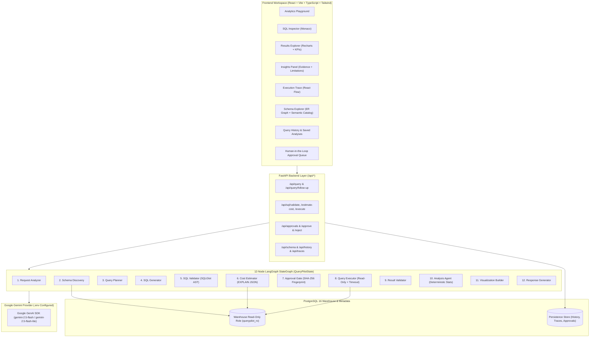
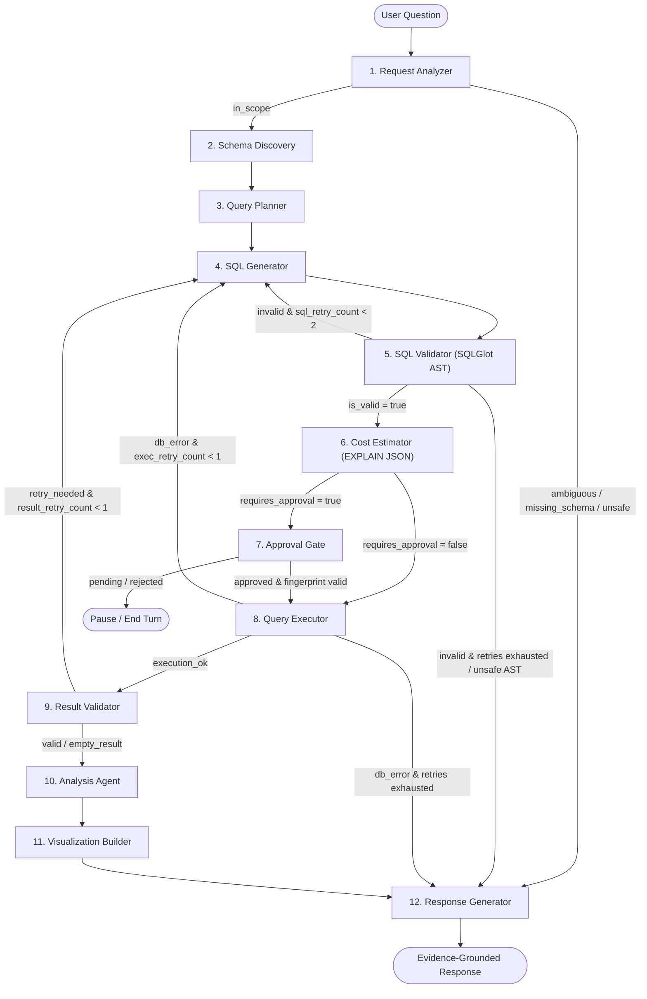
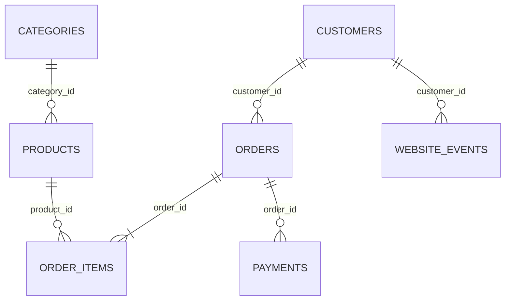

# QueryPilot — System & LangGraph Architecture

## 1. High-Level System Architecture

---

## 2. 12-Node LangGraph Workflow & Conditional Routing

QueryPilot implements a strongly typed `QueryPilotState` orchestrated by a LangGraph `StateGraph` with **three independent bounded retry counters** (`sql_retry_count`, `exec_retry_count`, `result_retry_count`) to prevent infinite loops:

---

## 3. E-Commerce Data Warehouse Schema (`seed=42`)

---

## 4. Defense-in-Depth Safety & Approval Architecture

1. **Full-AST Structural SQL Validation (`sql_validator.py`):**
   - Uses `sqlglot.parse()` to reject multi-statement queries (`len(statements) != 1`).
   - Traverses the entire AST via `ast.walk()` so destructive operations hidden inside CTEs (`WITH del AS (DELETE FROM customers RETURNING *) SELECT * FROM del`), subqueries, `SELECT ... INTO`, or locking clauses (`FOR UPDATE`) are deterministically blocked.
   - Rejects dangerous PostgreSQL functions (`pg_sleep`, `pg_read_file`, `pg_terminate_backend`, `dblink`, `lo_import`) and system schemas (`pg_catalog`, `information_schema`, `pg_shadow`).
   - Verifies all referenced tables and qualified columns against the discovered warehouse schema.
2. **Database-Level Read-Only Enforcement (`engine.py` & `init_ro_role.sql`):**
   - Queries execute via `querypilot_ro`, a dedicated PostgreSQL role configured with `ALTER ROLE querypilot_ro SET default_transaction_read_only = on`.
   - Every query execution opens a read-only transaction (`SET LOCAL TRANSACTION READ ONLY`) with `SET LOCAL statement_timeout = '5000ms'` and fetches at most `max_rows + 1` rows at the cursor level.
3. **Context-Bound Approval Gate (`routes_approval.py` & `persistence.py`):**
   - Computes a SHA-256 `context_fingerprint` over `(normalized_sql, database_role, max_rows, timeout_ms)`.
   - If the SQL or execution context changes after an approval request is created, the approval is invalidated (`409 Conflict`).
   - Atomic `approval_executed` locking prevents duplicate execution on repeated approval requests.
