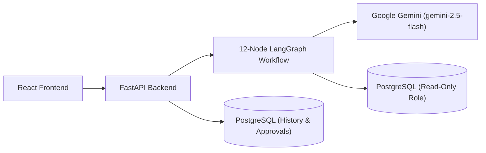
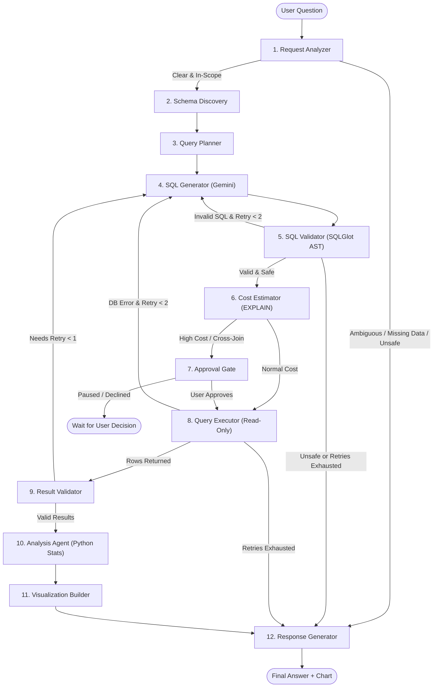
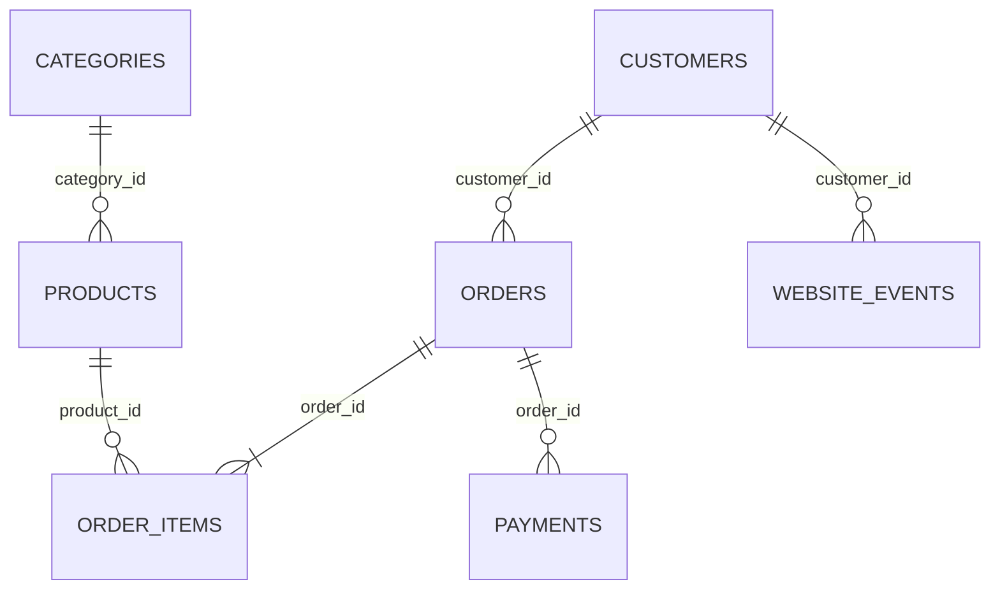

# QueryPilot — System Architecture

QueryPilot is divided into three layers:
1. **React Frontend:** A user-focused analytics interface for asking questions, viewing charts and summaries, reviewing high-cost query approvals, and browsing available data tables.
2. **FastAPI & LangGraph Backend:** A 12-node workflow that analyzes questions, discovers schema, writes and validates SQL with Google Gemini and SQLGlot, checks query cost, and computes statistics.
3. **PostgreSQL Database:** Stores the e-commerce dataset (queried via a read-only role `querypilot_ro`) and application metadata (saved history and approvals).

---

## 1. System Overview

---

## 2. LangGraph 12-Node Workflow

Every question passes through a structured LangGraph state machine with separate bounded retry counters (`sql_retry_count`, `exec_retry_count`, `result_retry_count`):

### Node Responsibilities

| # | Node | Role |
|---:|---|---|
| 1 | **Request Analyzer** | Identifies metrics, dimensions, and time ranges; stops early if the prompt is vague, unsafe, or asks for unmodeled data. |
| 2 | **Schema Discovery** | Reads live tables, columns, foreign keys, and metric formulas from PostgreSQL. |
| 3 | **Query Planner** | Plans required tables, joins, filters, and aggregations. |
| 4 | **SQL Generator** | Uses Gemini to generate a single PostgreSQL `SELECT` query from the discovered schema. |
| 5 | **SQL Validator** | Uses SQLGlot AST parsing to block DDL/DML, writable CTEs, dangerous functions, system schemas, and invalid columns. |
| 6 | **Cost Estimator** | Runs `EXPLAIN (FORMAT JSON)` to estimate execution cost and detect cartesian joins without running the query. |
| 7 | **Approval Gate** | Pauses expensive queries with a SHA-256 context fingerprint until a user approves or declines them. |
| 8 | **Query Executor** | Runs the query via `querypilot_ro` with `SET LOCAL TRANSACTION READ ONLY`, a 5-second timeout, and a 500-row cap. |
| 9 | **Result Validator** | Checks for empty results, nulls, or unexpected shapes. |
| 10 | **Analysis Agent** | Computes totals, averages, top/bottom performers, and percentage shares in Python. |
| 11 | **Visualization Builder** | Chooses the chart specification (`bar`, `line`, `area`, `pie`, or `composed`). |
| 12 | **Response Generator** | Produces the executive summary, key takeaways, calculation assumptions, and limitations. |

---

## 3. Database Schema (7 Tables)

---

## 4. Safety Controls

- **AST Validation (`sql_validator.py`):** Full syntax tree walk blocks multi-statement queries, writable CTEs (`WITH del AS (DELETE ...)`), `SELECT INTO`, `FOR UPDATE`, `pg_sleep`, `pg_read_file`, and `pg_catalog`.
- **Database Role (`querypilot_ro`):** Enforces read-only transactions at the PostgreSQL engine level.
- **Tamper-Proof Approvals (`persistence.py`):** Binds each approval to a SHA-256 hash of the SQL and execution limits, invalidating stale approvals and preventing duplicate runs.
